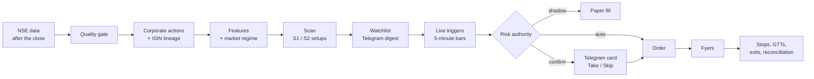

# Hire a Trader (HAT)

**Two disciplined swing-trading bots for the Indian stock market (NSE) that do the homework every
night and ask you before they spend a rupee.**

HAT watches every NSE equity, finds the few setups worth trading, sizes them against a written risk
policy and sends you a card on Telegram. You tap **Take** or **Skip**. Once you take a trade, the
bot owns its whole life: stop-loss, GTT orders, trims, exits, corporate actions and reconciliation
with the broker.

> Status: built and running on paper. Each bot has to clear a backtest of at least five years on
> real data and a stretch of daily paper trading before it touches real money.

---

## Why HAT

- **Rules, not moods.** Two well-known swing styles, written down as code:
  - **S1 `stage2-contraction-breakout`**: Minervini-style. Stage-2 uptrends that tighten into a
    volatility contraction, bought on the breakout.
  - **S2 `momentum-breakout-ep`**: Qullamaggie-style. Momentum leaders breaking out, plus episodic
    pivots (gap-ups on news, with the NSE announcement attached).
- **You stay in charge.** Every bot runs in one of three modes, switched per bot:
  - `shadow` (paper trading, virtual fills, never at the broker)
  - `confirm` (a Telegram card per entry; you approve each one)
  - `auto` (high-confidence signals only)

  Signals carry a high / medium / low confidence label.
- **Risk first.** One risk authority checks every order before it leaves: position sizing, caps,
  exposure ladder, price bands, drawdown kills and kill switches you can hit from your phone
  (`/kill`, `/pause`, `/flatten`).
- **Clean data, so the signals are real.** Fifteen years of NSE history (from 2011) built from free,
  official NSE sources.
  - Every split, bonus, rights issue and demerger is adjusted for, and ISIN changes are
    linked into one history per company, so a split or a demerger never looks like a crash.
  - Dividends count: the signals read a total-return series, and the cash is credited on each
    ex-date to the shares held into it, so a trade's P&L and R include the dividends it earned.
  - Delisted stocks stay in the history, so backtests carry no survivorship bias.
- **Nothing is hidden.** Every state change is written to an append-only event log in the same
  transaction, and trade state can be replayed from it.

---

## How it works



**Every evening (from 18:00 IST):**
1. Ingest the day's prices, indices and breadth.
2. Gate the data quality.
3. Apply corporate actions.
4. Compute features.
5. Read the market regime, with a 3-day confirmation.
6. Size each bot's sleeve.
7. Scan. You get the watchlist on Telegram.

**During the session:**
1. Live ticks become 5-minute bars, and the trigger monitor fires on the watchlist.
2. Each signal goes through the risk authority and then the bot's mode.
3. Filled positions get an intraday stop, swapped to a GTT before the close.
4. Exits run on rules: moving-average exits, trims and stops.
5. A nightly job verifies every GTT against the broker.

**Your controls:**
- **Telegram:** `/status`, `/positions`, `/watchlist`, `/mode`, `/pause`, `/resume`, `/kill`,
  `/flatten`, `/login`, `/arm`.
- **Dashboard:** a read-only React page.
- **Admin:** a local command line.

**Under the hood:**
- One FastAPI process on PostgreSQL.
- Market data in Parquet, queried with DuckDB.
- Fyers is the broker.
- All trading code lives in `backend/app/hat/`.

---

## Run it

Python 3.14, PostgreSQL 18, Node 26 and pnpm are required.

```bash
# backend, from the repo root
python -m venv venv
source venv/bin/activate          # Windows: venv\Scripts\activate
python scripts/install_backend_deps.py
cp .env.example .env              # fill in DB_* and the Fyers credentials
python backend/start_server.py    # http://127.0.0.1:8000

# frontend, in a second terminal
cd frontend
pnpm install
pnpm dev                          # http://127.0.0.1:3000, proxies /api to the backend
```

- **Database.** Point `DB_*` at a fresh PostgreSQL database. The schema is created at startup;
  HAT refuses any other database engine.
- **Data.** Market data lives under `HAT_DATA_ROOT` (default `data_system/hat/`, gitignored).
- **Turn the bots on.** The scheduler, live feed and Telegram bot start only with
  `HAT_ENABLED=true` (default false). Without it the server serves the login and dashboard routes
  only. `.env.example` lists every variable.

### Build the history (once per data root)

From `backend/` with the venv active:

```bash
python -m app.hat.data.history_cli [--from 2011-06-22] [--to YYYY-MM-DD] [--resume]
python -m app.hat.data.lineage build      # link ISIN changes into one history per company
python -m app.hat.data.features --full    # compute the scan features for every date
```

After that the nightly cycle keeps everything current. `lineage report` and `lineage show SYMBOL`
list what needs review. First-deploy steps (risk policy, broker account, bots, universe) are in
`docs/runbook.md`.

---

## Docs

| Doc | What's in it |
| --- | --- |
| `docs/architecture.md` | Module map, data flow, daily schedule, startup and routes |
| `docs/invariants.md` | The money-safety and trading rules the code keeps |
| `docs/decisions.md` | The decisions in force |
| `docs/runbook.md` | Operating it: start, login, first deploy, failures |
| `CLAUDE.md` | Development guide: checks, repo rules |

## Checks

```bash
ruff format --check . && ruff check .      # from the repo root
cd frontend && pnpm check && pnpm test     # frontend
```

`CLAUDE.md` lists the backend test commands and the CI jobs.

---

## Disclaimer

HAT is a personal trading tool, not investment advice. Trading involves risk of loss; past or
backtested results do not guarantee future returns. Use it at your own risk.

## License

See `LICENSE`.
